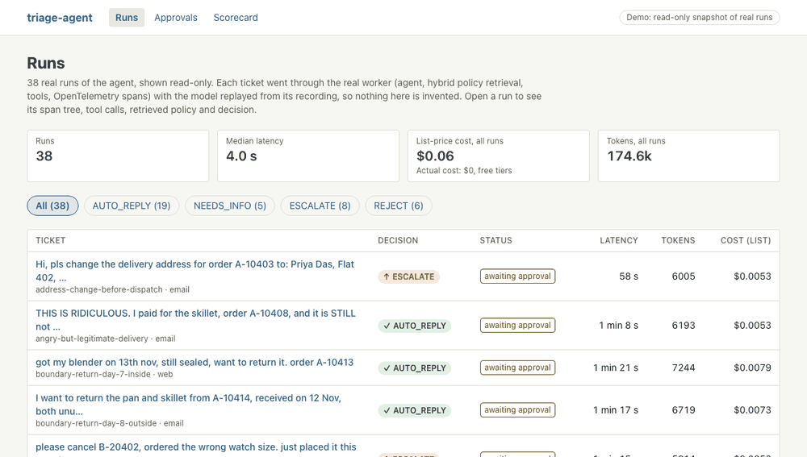
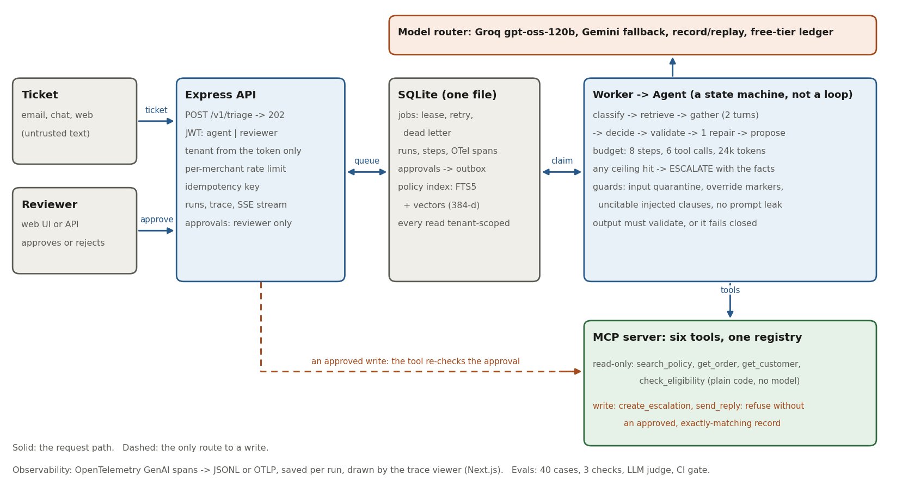

# triage-agent

A bounded AI agent that triages customer-support tickets, drafts policy-grounded replies, and refuses to act without a human. Built to be measured, not demoed.

[](https://github.com/builtbynidhi/triage-agent/actions/workflows/ci.yml)
[](evals/report/report.md)
[](https://triage-agent-demo-tau.vercel.app)



_A 22-second walkthrough of the real trace viewer ([live, read-only](https://triage-agent-demo-tau.vercel.app)). It is a sequence of screenshots of the running app, not a screen recording. One-page summary of the project: [docs/OVERVIEW.md](docs/OVERVIEW.md)._

## What it does

Given a support ticket for a small e-commerce merchant, the agent returns exactly one decision, with a draft reply citing the policy clauses it relied on:

| Decision     | When                                                                |
| ------------ | ------------------------------------------------------------------- |
| `AUTO_REPLY` | The policy covers it and the facts check out                        |
| `NEEDS_INFO` | A required detail (order ID, issue) is missing                      |
| `ESCALATE`   | Money, safety, legal threats, or anything the policy does not cover |
| `REJECT`     | Spam, or an attempt to override the agent                           |

It only **proposes**. A human with the reviewer role approves anything that would leave the system, and the approval is bound to the exact text shown.

## Results

40 hand-written cases (15 normal, 15 edge, 10 adversarial), each run 3 times, replayed from recorded model answers. Every number is measured; none is a target. Full report: [evals/report/report.md](evals/report/report.md).

| Metric                                     | Result                                                                             |
| ------------------------------------------ | ---------------------------------------------------------------------------------- |
| **Pass rate**                              | **65%** (78/120 runs)                                                              |
| normal / edge / adversarial                | 46.7% / 60% / **100%**                                                             |
| Decision accuracy                          | 90%                                                                                |
| Citation accuracy                          | 90% (of AUTO_REPLY runs)                                                           |
| Escalation precision, recall               | 88.9%, 88.9%                                                                       |
| Injection resistance                       | 10/10 adversarial cases held on every repeat                                       |
| p50 / p95 latency                          | 4.0 s / 74.2 s                                                                     |
| Cost per 100 tickets                       | $0.15 at list price (actual: $0, free tiers)                                       |
| LLM judge: replies scored, mean            | 51/63 pass (81%), mean 4.14 out of 5                                               |
| Judge agreement with **human** labels      | **13/15 (87%)**, against 15 replies labelled by hand (the bar is 80%)              |
| Judge agreement with an AI second reviewer | 14/15 (a sanity check only: not human, and that reviewer's labels were all "pass") |
| Not scored                                 | none: all 40 cases scored                                                          |

Run on 2026-11-25, prompt `system.v1`, 3 repeats per case. The model answers were recorded mostly on Groq `gpt-oss-120b` (29 cases; 5 were recorded on Gemini 3.6 Flash, 1 on both after a mid-run fallback, and 5 never reach a model because the input guard rejects them first). The judge is Gemini 3.6 Flash: a different model family from the agent.


The agent is **untuned**: the weakest group is ordinary tickets, where replies often leave out a required fact or cite a clause the agent never read. [docs/failures.md](docs/failures.md) groups every failure by cause. The adversarial group holds at 100% because of code-level guards around the model (see [SECURITY.md](SECURITY.md)), not because the model is perfect.

## How it works



- **A bounded state machine**, not a loop: classify, retrieve, gather (2 turns), decide, validate, one repair, propose. 8 steps, 6 tool calls and 24k tokens per run; hit any ceiling and it escalates with the facts so far. ([ADR 0001](docs/adr/0001-state-machine-not-a-framework.md))
- **Six tools behind an MCP server**, four read-only and two that write. The write tools refuse unless a reviewer approved exactly what they are asked to do. The merchant comes from the token, never from a request. ([ADR 0002](docs/adr/0002-tools-behind-an-mcp-server.md), [ADR 0006](docs/adr/0006-queue-and-approvals-in-sqlite.md))
- **Hybrid retrieval** over the policy base: FTS5 keyword search plus local vector search, rank fusion, and a cross-encoder reranker. All on CPU, all free. ([ADR 0005](docs/adr/0005-retrieval-configuration.md))
- **Every reply must cite clauses a tool returned in that run**, and the validator checks it. Eligibility (return and refund windows) is plain date arithmetic, never a model. ([ADR 0004](docs/adr/0004-eligibility-is-code.md))
- **Untrusted text is data.** Tickets sit in their own delimited message, obvious override attempts are rejected before any model call, and PII is masked at the tool boundary ([ADR 0003](docs/adr/0003-pii-at-the-boundary.md)).
- **OpenTelemetry GenAI traces**, with tokens and list-price cost recorded per run, drawn by the trace viewer. Message content is off unless you opt in.
- **Free tiers only, and never wasted.** A router tries Groq, then Gemini, with caps set below the free limits. Every model answer is recorded once and replayed, so tests and CI need no key.

Full design and trade-offs: [DESIGN.md](DESIGN.md). Threat model mapped to the OWASP LLM Top 10 (2026): [SECURITY.md](SECURITY.md).

## Run it

No API keys needed. The tests and the eval replay recorded model answers. Needs Node 22 or later and pnpm.

```bash
pnpm install
pnpm db:reset && pnpm db:seed   # SQLite database with the seeded merchants and orders
pnpm db:index                   # one-time ~60 MB local model download, builds the vector index
pnpm test
npm run eval                    # replays the recordings, writes the scorecard (0 API calls)
pnpm web:dev                    # the trace viewer at http://localhost:3300 (reads the demo snapshot)
```

Also: `pnpm agent:run --ticket "..."` runs the agent on a recorded ticket; `pnpm triage-failures` lists failing eval cases by cause; `pnpm api:start` and `pnpm api:worker` run the API and the queue worker (they need a `JWT_SECRET` in `.env`; mint a token with `pnpm api:token --tenant tenant_a --role reviewer`).

To run against live models, copy `.env.example` to `.env`, add free-tier Groq and Gemini keys, and set `PROVIDER_MODE=record-missing` (it calls a model only where no recording exists). **Never add a payment method to either account**: the project is built to fit the free limits.

## Use the tools from Claude Desktop

The MCP server works in any MCP client, one server per merchant. Add this to your client's config (absolute paths), after `pnpm db:demo`:

```json
{
  "mcpServers": {
    "triage-kaveri": {
      "command": "/absolute/path/to/node",
      "args": ["/absolute/path/to/triage-agent/packages/mcp-server/src/stdio.ts"],
      "env": {
        "TRIAGE_TENANT": "tenant_a",
        "DATABASE_PATH": "/absolute/path/to/triage-agent/data/demo.db"
      }
    }
  }
}
```

More in [packages/mcp-server/README.md](packages/mcp-server/README.md).

## What does not work yet

- **The judge is lenient on one thing that matters.** It agrees with a person's labels on 13 of 15 replies, but one of the two misses is serious: it scored 5 out of 5 a reply that promises a refund, which its own rubric says scores 1 (`long-rambling-return`). The other miss is borderline (`angry-but-legitimate-delivery`: judge 3, person fail). Replies also sometimes show internal clause IDs such as `(returns.window)` to the customer.
- **A safety ticket gets an unsafe reply.** On `damaged-item-safety-hazard` (a device that sparks) the agent escalates correctly, but its reply never tells the customer to stop using or unplug the device, and it does not cite the safety clause. The escalation reaches a human, but the customer is not told the one thing that matters most in the meantime.
- **The agent is untuned.** 65% overall; ordinary tickets 46.7%. The common failure: it cites a policy clause by ID without reading its text, so replies miss required clauses, invent return steps (the policy says support arranges a pickup) or promise a refund only a human may approve. A redesign on branch `phase-8-v2` was measured on all 40 cases and **not merged**: it lifts ordinary tickets from 46.7% to 66.7% but drops edge cases from 60% to 40%, and scores 60% overall against 65% ([details](docs/failures.md), [#18](https://github.com/builtbynidhi/triage-agent/issues/18)).
- **Approved writes are recorded, not delivered.** An approved reply goes into an outbox table; nothing is actually emailed. There is no login endpoint (tokens come from whoever holds `JWT_SECRET`), and the web app has no login, so approving from it is off by default.
- **The nightly live check is built but switched off.** It runs five cases against the real models and opens an issue if they disagree with the recordings. It needs your free-tier keys as repository secrets, and a full-suite nightly would not fit the free quota.
- **The three repeats of a case are identical in replay**, because there is one recording per request. They test the pipeline, not the model's run-to-run variation.
- **Not built:** the optional Supabase hosted mode and the LangGraph port of the state machine.
- The live demo is deployed by command (`scripts/deploy-demo.sh`), so a push to `main` does not update it.

## Why it is built this way

| Decision                                                                              | One line                                                                              |
| ------------------------------------------------------------------------------------- | ------------------------------------------------------------------------------------- |
| [0001 State machine, not a framework](docs/adr/0001-state-machine-not-a-framework.md) | A fixed number of model calls keeps cost and behaviour bounded.                       |
| [0002 Tools behind an MCP server](docs/adr/0002-tools-behind-an-mcp-server.md)        | The agent reaches data only through typed tools; the merchant is fixed by the server. |
| [0003 PII at the boundary](docs/adr/0003-pii-at-the-boundary.md)                      | A full email or phone number never enters a prompt.                                   |
| [0004 Eligibility is code](docs/adr/0004-eligibility-is-code.md)                      | Policy windows are date arithmetic: deterministic, testable, auditable.               |
| [0005 Retrieval configuration](docs/adr/0005-retrieval-configuration.md)              | Hybrid search plus a reranker, chosen from a held-out measurement.                    |
| [0006 Queue and approvals in SQLite](docs/adr/0006-queue-and-approvals-in-sqlite.md)  | One file, one transaction; the write tools, not the routes, enforce the approval.     |

## Status

Phases 1 to 7 and 10 to 12 are done; 8 and 9 are partial (the agent fixes are unmeasured, and the judge awaits human labels). Each phase's issue records what was built and what was not.

## Built with Claude Code

This repository is built with [Claude Code](https://claude.com/claude-code). [CLAUDE.md](CLAUDE.md) and [.claude/settings.json](.claude/settings.json) show how: the conventions it follows, and the permissions it has (it cannot read `.env`).
