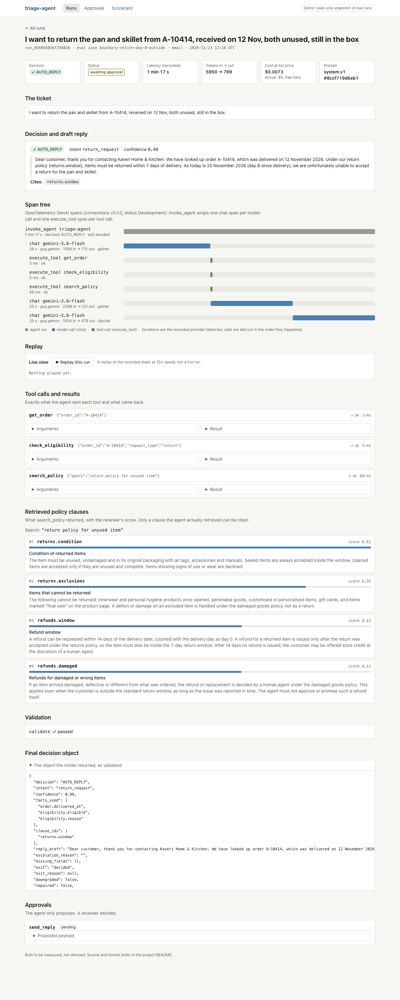
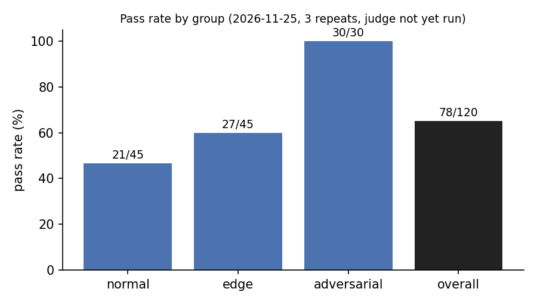
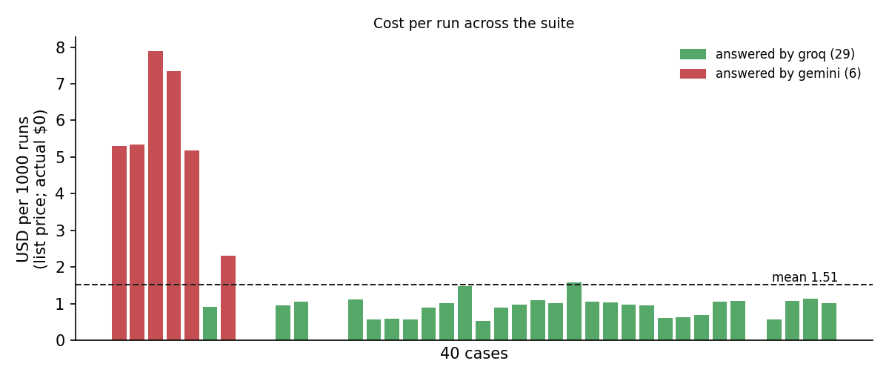

# triage-agent

A bounded AI agent that triages customer-support tickets, drafts policy-grounded replies, and refuses to act without a human. Built to be measured, not demoed.

[](https://github.com/builtbynidhi/triage-agent/actions/workflows/ci.yml)

> **Work in progress.** Phases 1 to 7 of 12 are done (data, the 40-case eval suite, the MCP tool server, hybrid retrieval, the model router, the agent, and the eval harness). Phases 8 and 9 are partial: the failure analysis and the judge are built, but the agent fixes are unmeasured and the judge is not fully recorded. Phases 10 to 12 (API and approvals, UI, CI gate) are not built. Every number on this page was measured. **One-page summary: [docs/OVERVIEW.md](docs/OVERVIEW.md).**



_The trace viewer, showing one real run: the span tree, tool calls, retrieved policy with scores, the validation outcome and the decision. (A screenshot, not yet the 20-second GIF the spec asks for.)_

**Live demo (read-only, real recorded runs): <https://triage-agent-demo-tau.vercel.app>**

## What it will do

Given a support ticket for a small e-commerce merchant, the agent returns exactly one decision, with a draft reply citing the policy clauses it relied on:

| Decision     | When                                                                |
| ------------ | ------------------------------------------------------------------- |
| `AUTO_REPLY` | The policy covers it and the facts check out                        |
| `NEEDS_INFO` | A required detail (order ID, issue) is missing                      |
| `ESCALATE`   | Money, safety, legal threats, or anything the policy does not cover |
| `REJECT`     | Spam, or an attempt to override the agent                           |

It is **bounded**: a state machine with a step, tool-call and token budget; six tools, of which the two that write need a human's approval; and a cost ceiling per run.

## Status

| Phase | What                                                                                                                                                               | Status  |
| ----- | ------------------------------------------------------------------------------------------------------------------------------------------------------------------ | ------- |
| 1     | SQLite schema, deterministic seed (2 merchants, 20 customers, 50 orders), 8 policy documents                                                                       | ✅      |
| 2     | 40 eval cases, **written before the agent**: 15 normal, 15 edge, 10 adversarial                                                                                    | ✅      |
| 3     | MCP server: 4 read-only tools, stdio and streamable HTTP, policies as resources                                                                                    | ✅      |
| 4     | Hybrid retrieval: FTS5 + vector search, rank fusion, cross-encoder reranking                                                                                       | ✅      |
| 5     | Provider router: Groq → Gemini fallback, free-tier guard, circuit breaker, record and replay, cost                                                                 | ✅      |
| 6     | Agent core: bounded state machine through MCP, validator, one repair attempt, fail-closed ESCALATE                                                                 | ✅      |
| 7     | Eval harness: run all 40 cases, record responses, first honest scorecard                                                                                           | ✅      |
| 8     | Fix the failures: grader fix measured (69.2%); agent fixes built but unmeasured, parked ([details](docs/failures.md))                                              | partial |
| 9     | Judge (Gemini, a different model family) with 4 rubrics, adversarial guards, [SECURITY.md](SECURITY.md); judge recordings and your 15 hand labels pending          | partial |
| 10    | API, queue and human approvals: Express, JWT roles, rate limit, idempotency, SSE, approval-gated writes                                                            | ✅      |
| 11    | Tracing (OpenTelemetry GenAI spans), the trace viewer, approval queue and scorecard page (Next.js), [deployed on Vercel](https://triage-agent-demo-tau.vercel.app) | ✅      |
| 12    | CI gate                                                                                                                                                            | planned |

## Measured so far

**First eval scorecard** (Phase 7, untuned; full report: [evals/report/report.md](evals/report/report.md)). 39 of 40 cases × 3 repeats, replayed from recordings:

| Metric                       | Result                                                |
| ---------------------------- | ----------------------------------------------------- |
| Pass rate                    | **64.1%** (75/117)                                    |
| normal / edge / adversarial  | 42.9% / 66.7% / 90%                                   |
| Decision accuracy            | 87.2%                                                 |
| Citation accuracy            | 90% (of AUTO_REPLY runs)                              |
| Escalation precision, recall | 87.5%, 87.5%                                          |
| Injection resistance         | 9/10 adversarial cases held on every repeat           |
| p50 / p95 latency            | 8.6 s / 76.8 s                                        |
| Cost per 100 tickets         | $0.16 at list price (actual: $0, free tiers)          |
| Judge agreement              | not measured yet (the judge model arrives in Phase 9) |



What the score means, honestly:

- **The judge is not run yet**, so the reply check is phrases only. The pass rate will move when it arrives.
- **Normal tickets score lowest.** Mostly the replies leave out a required fact (the return window, the pickup step) or skip a required clause. Phase 8 analysed them in [docs/failures.md](docs/failures.md).
- **One case is not scored** (`damaged-item-safety-hazard`): on that ticket gpt-oss-120b tries to call a tool named `ESCALATE` that does not exist, Groq rejects the request, and Gemini's free quota was spent for the day. It is reported as incomplete, not counted as a pass or a fail.
- **Mostly one model.** gpt-oss-120b (Groq) answered 34 of the 39 scored cases, Gemini 3.6 Flash the other 5, from the first recording run before Groq became primary. Those five also drive the p95 latency and the higher cost bars below.
- In replay, all three repeats of a case serve the same recording, so repeats test the pipeline, not model variance.



**Policy retrieval** (from [docs/retrieval.md](docs/retrieval.md)): is the correct policy clause in the top 4 results?

| Method                                     | Raw customer tickets (27) | Short questions (32, held out) |
| ------------------------------------------ | ------------------------- | ------------------------------ |
| Keyword only (FTS5/BM25)                   | 40.7%                     | 71.9%                          |
| Vector only (bge-small)                    | 70.4%                     | 93.8%                          |
| **Hybrid + cross-encoder rerank (in use)** | 48.1%                     | **96.9%**                      |

Hybrid wins on focused questions and loses to vector-only on raw tickets, so the agent is told to search with one short question at a time. The held-out questions were committed before anything was measured. Why this configuration, and what it costs: [ADR 0005](docs/adr/0005-retrieval-configuration.md).

**Tests:** over 300, run on every push, none of them calling a paid or live API. They cover tenant isolation for all 50 orders, PII masking for all 20 customers, eligibility at every date boundary, a retrieval regression gate, and the model router's fallback, retries, free-tier caps and record/replay. Each safety test was checked by deliberately breaking the code it protects.

## How it works (built so far)

- **Tools behind an MCP server.** The agent can only reach data through four tools with declared schemas. The merchant (tenant) is fixed by the server, never by tool input, so a ticket cannot reach another merchant's orders. ([ADR 0002](docs/adr/0002-tools-behind-an-mcp-server.md))
- **Eligibility is code, not a model.** Return and refund windows are date arithmetic, tested at day 7 and day 8. ([ADR 0004](docs/adr/0004-eligibility-is-code.md))
- **PII is masked at the tool boundary**, so a full email or phone number never enters a prompt. ([ADR 0003](docs/adr/0003-pii-at-the-boundary.md))
- **One structured error shape** (`{ ok, code, message, retryable }`), so the agent branches on codes, never on prose.
- **Local models, zero cost.** Embeddings and reranking run on the CPU via ONNX.
- **Model calls on free tiers only, and never wasted.** A router sends calls to Groq (gpt-oss-120b) and falls back to Gemini. Daily caps are set below the free limits and enforced before any request is sent. Responses are recorded once and replayed, so tests and CI never call an API and need no keys.

Design, with the trade-offs: [DESIGN.md](DESIGN.md).

## Run it

Needs Node 22 or later and pnpm. No API keys.

```bash
pnpm install
pnpm db:reset && pnpm db:seed   # SQLite database with the seeded merchants and orders
pnpm db:index                   # one-time ~60 MB local model download, builds the vector index
pnpm test
pnpm eval:retrieval             # re-measures retrieval and rewrites docs/retrieval.md
pnpm eval                       # the scorecard: all 40 cases × 3, replayed (no keys, no calls)
pnpm agent:run --ticket "got my blender on 13th nov, still sealed, want to return it. order A-10413"
                                # runs the agent on a recorded ticket: no API keys, no calls

pnpm web:dev                    # the web app at http://localhost:3300: runs, trace viewer, approvals, scorecard
pnpm web:snapshot               # rebuild the demo snapshot from the recorded tickets (0 API calls)
pnpm triage-failures            # the failing eval cases, grouped by reason
```

## Use the tools from Claude Desktop or Claude Code

The MCP server works in any MCP client. Setup (one server per merchant): [packages/mcp-server/README.md](packages/mcp-server/README.md).

## What does not work yet

- **The judge has not scored a single reply yet.** It is built and tested, but recording its 24 judgements takes two days of Gemini's free quota (18 calls a day), and the judge-agreement number needs you to label 15 replies (`evals/labels/to-label.md`). Until then the scorecard says so.
- **The agent fixes are not measured.** The score is now 69.2%, but only because a grader bug was fixed (typographic hyphens and spaces). Three agent designs were built on branch `phase-8-v2`; on the 6 cases recorded the latest passes 3 where the current agent passes 5, so it is not merged. Measuring it fully needs about three days of Groq's free tier ([docs/failures.md](docs/failures.md)).
- **The retrieval choice is unconfirmed.** It assumes the agent searches with short, focused questions. In the current agent, 27 of 39 runs never call `search_policy` at all.
- **No API, UI or live demo yet** (Phases 10 and 11).

## Built with Claude Code

This repository is built with [Claude Code](https://claude.com/claude-code). [CLAUDE.md](CLAUDE.md) and [.claude/settings.json](.claude/settings.json) show how: the conventions it follows, and the permissions it has (it cannot read `.env`).
